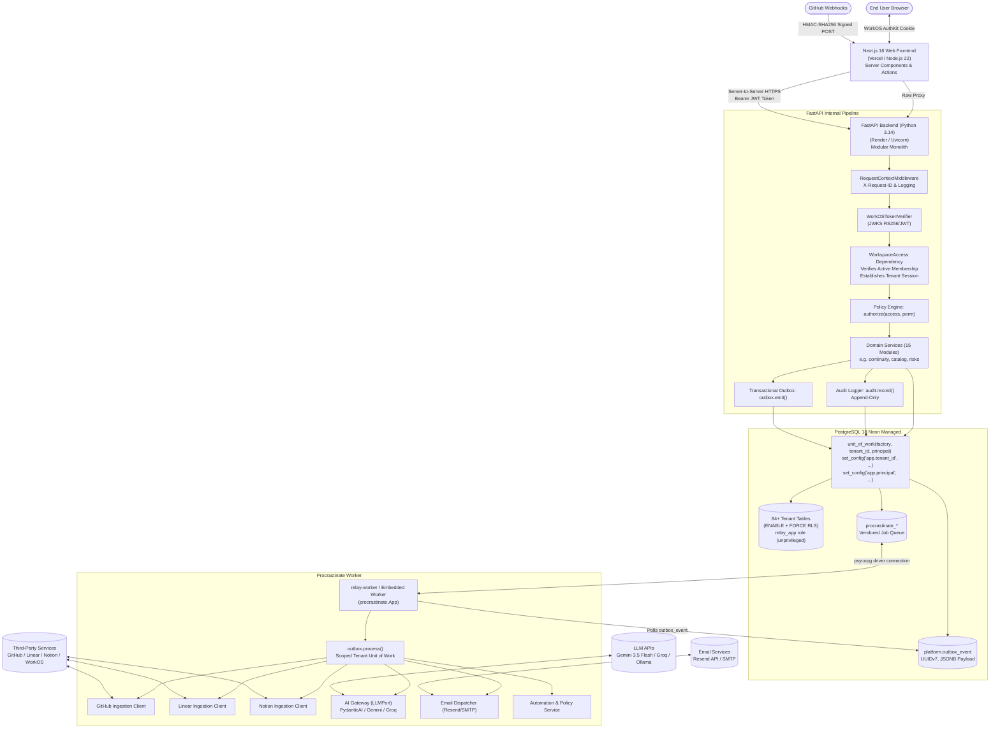
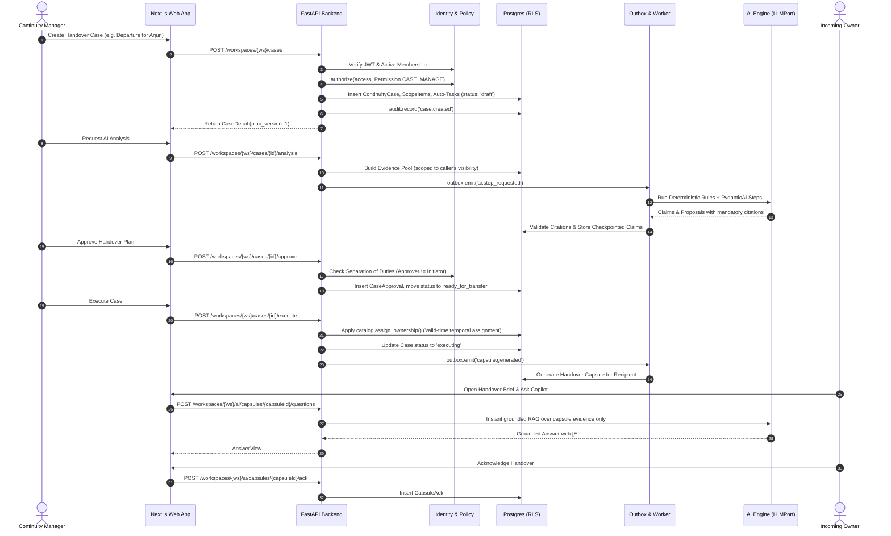
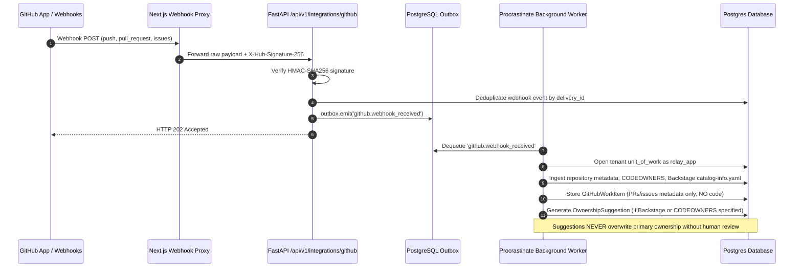

# 01 - Architecture & System Topology

## 1. System Topology Overview

Relay is architected as an **Enterprise Multi-Tenant Modular Monolith** designed around strict cryptographic and database-level tenancy boundaries. It does not use distributed microservices, external queue brokers (like RabbitMQ or Redis), or external vector/graph databases. Instead, PostgreSQL 18 with Row-Level Security (RLS) is the single source of truth, queue broker, event outbox, full-text search engine, and rate-limiting store.



---

## 2. Core Design Patterns

### 2.1 The Two-Role Database Tenancy Pattern
* **`relay_owner`**: The deployment and migration role. Owns all schemas, tables, sequences, and extensions (`uuidv7`, `pgvector`). Runs `alembic upgrade head`.
* **`relay_app`**: The application connection role. Owns no tables, has no `BYPASSRLS`, cannot alter schemas, and cannot truncate or delete audit logs. Connects via connection pooling.
* **Transaction-local RLS configuration**: All database queries are guarded by `unit_of_work()`. At the start of every transaction (`after_begin` event), it issues:
  ```sql
  SELECT pg_catalog.set_config('app.tenant_id', :tenant_id, true),
         pg_catalog.set_config('app.principal', :principal, true),
         pg_catalog.set_config('app.principal_email', :principal_email, true);
  ```
  `is_local => true` guarantees these parameters never leak into pooled connections across transactions.

### 2.2 Transactional Outbox Pattern (Outbox + Queue Co-Commit)
Relay guarantees zero delivery gaps without separate message brokers:
1. When a domain service performs a mutation, it writes an `OutboxEvent` to `platform.outbox_event` inside the active transaction.
2. In the exact same transaction, it accesses the raw psycopg connection and registers a deferred Procrastinate job:
   ```python
   connection = await (await session.connection()).get_raw_connection()
   await jobs.tasks["relay.process_outbox_event"].configure(
       connection=connection.driver_connection,
       schedule_at=schedule_at
   ).defer_async(tenant_id=str(tenant_id), event_id=str(event_id))
   ```
3. If the transaction commits, both the domain mutation and the queue entry are guaranteed to exist. If it rolls back, no spurious jobs ever run.
4. The background consumer (`outbox.process()`) locks the row with `SELECT ... FOR UPDATE`, checks idempotent execution, runs the handler within tenant RLS, and marks it processed.

### 2.3 Layered Separation of Concerns
```
Next.js Server Component / Action
       │ (1) reads encrypted session cookie (WorkOS AuthKit)
       ▼
Frontend Relay API Client (src/lib/relay-api.ts)
       │ (2) attaches Authorization: Bearer <token>
       ▼
FastAPI Routers (src/relay/<module>/api.py)
       │ (3) parses input via Pydantic StrictInput subclasses
       │ (4) validates WorkOS JWT via Identity dependency
       │ (5) resolves workspace membership & binds RLS via CurrentWorkspace
       ▼
Domain Service Layer (src/relay/<module>/service.py)
       │ (6) enforces access control via authorize(access, Permission)
       │ (7) writes audit event via audit.record()
       │ (8) executes business logic & SQL mutations via SQLAlchemy expressions
       │ (9) emits domain events via outbox.emit()
       ▼
PostgreSQL Database
```

---

## 3. High-Level Data Flow Diagrams

### 3.1 Handover Case Lifecycle & Execution Flow



### 3.2 Ingestion & Evidence Reconciliation Flow


