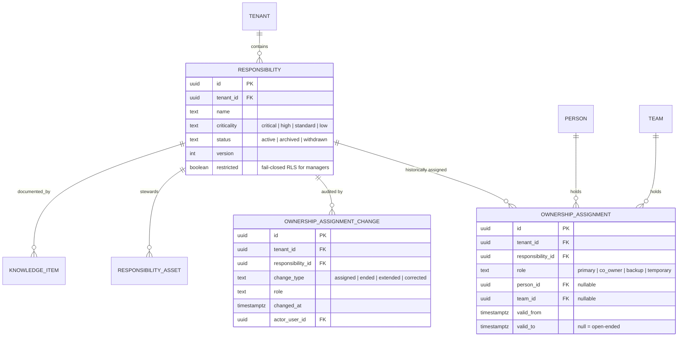
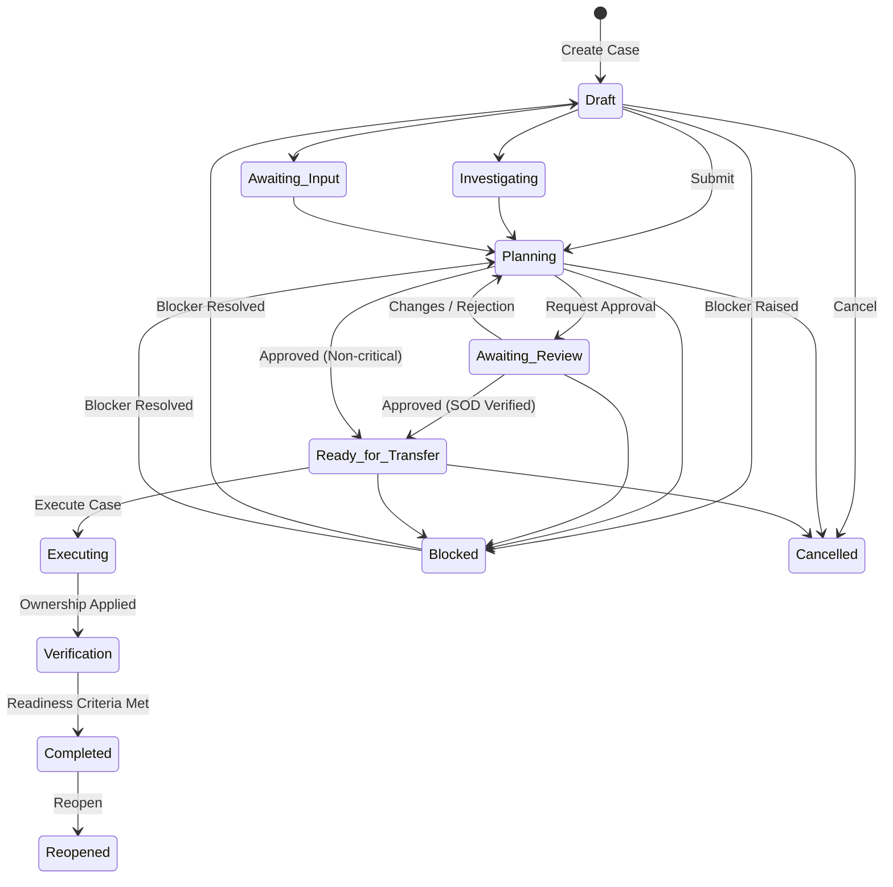
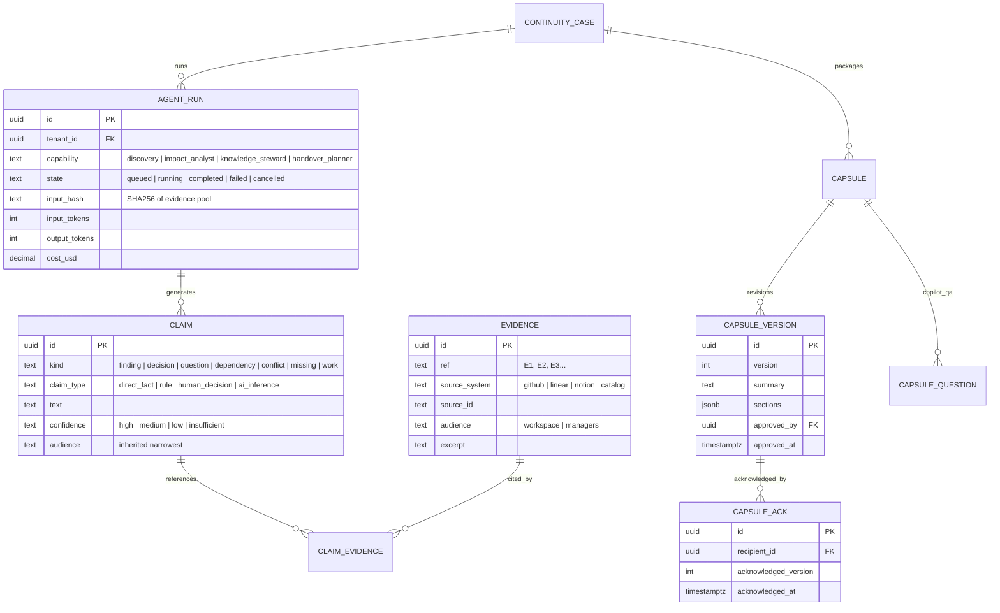
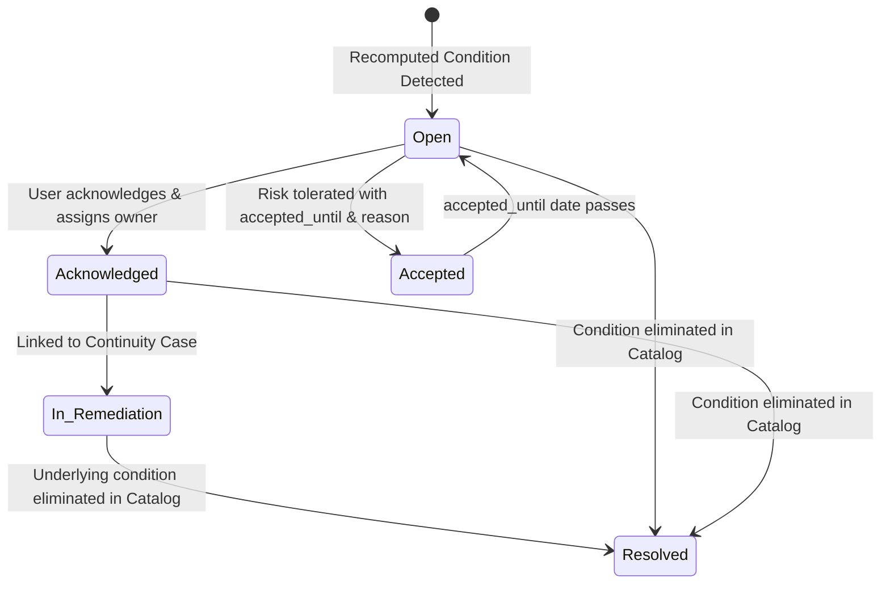

# 03 - Domain Models & Database Schemas

## 1. Schema Conventions & Tenancy Invariants

Every tenant table in Relay strictly adheres to non-negotiable database-level guardrails verified by `tests/security/test_schema_conventions.py`:
1. **Tenant Column**: `tenant_id NOT NULL` referencing `platform.tenant(id)`.
2. **Primary Key**: UUIDv7 generated server-side or via PostgreSQL function `uuidv7()`.
3. **Composite Foreign Keys**: All inter-table references use composite foreign keys:
   `FOREIGN KEY (tenant_id, target_id) REFERENCES schema.table(tenant_id, id)`.
4. **Unique Constraints**: All unique indexes and constraints start with `tenant_id` to prevent cross-tenant collision.
5. **Forced Row-Level Security (RLS)**:
   ```sql
   ALTER TABLE schema.table ENABLE ROW LEVEL SECURITY;
   ALTER TABLE schema.table FORCE ROW LEVEL SECURITY;
   CREATE POLICY tenant_isolation_policy ON schema.table
       FOR ALL
       TO relay_app
       USING (tenant_id = NULLIF(current_setting('app.tenant_id', true), '')::uuid)
       WITH CHECK (tenant_id = NULLIF(current_setting('app.tenant_id', true), '')::uuid);
   ```

---

## 2. Core Domain Entities & Mutation Mechanics

### 2.1 The Responsibility & Valid-Time Ownership Engine (`catalog`)

Ownership is not a simple foreign key; it is a **valid-time temporal continuum** with full auditability.



#### Mutation Mechanics & Invariants:
1. **PostgreSQL EXCLUDE Constraint**: Prevents temporal collision of primary owners at the database level:
   ```sql
   ALTER TABLE catalog.ownership_assignment
   ADD CONSTRAINT exclude_overlapping_primary_assignments
   EXCLUDE USING gist (
       tenant_id WITH =,
       responsibility_id WITH =,
       tstzrange(valid_from, valid_to, '[)') WITH &&
   ) WHERE (role = 'primary');
   ```
2. **Assignee Exclusivity**: A CHECK constraint guarantees that exactly ONE of `person_id` or `team_id` is set, never both or neither.
3. **Temporal Slicing (`catalog.service.assign_ownership`)**:
   - When a new primary owner is assigned as of `valid_from`, any currently active primary assignment is automatically truncated to `valid_to = valid_from`.
   - An immutable record is appended to `ownership_assignment_change`.
   - The responsibility's `version` is incremented.

---

### 2.2 The Continuity Case Lifecycle Engine (`continuity`)

The continuity case manages ownership transfers, leave coverages, departures, and onboardings through an audited Finite State Machine.



#### Key Lifecycle Invariants (`continuity.lifecycle` & `continuity.service`):
1. **Plan Versioning (`plan_version`)**:
   - Any modification to scope (`CaseScopeItem`), recipients, tasks (`CaseTask`), or effective dates increments `plan_version`.
   - Prior approvals (`CaseApproval`) are strictly bound to a specific `plan_version`. If the plan is edited after approval, the case reverts to `planning` and previous approvals become invalid.
2. **Separation of Duties (SOD)**:
   - For critical cases, the approver (`CaseApproval.actor_user_id`) CANNOT be the initiator (`ContinuityCase.initiator_user_id`), unless an audited SOD exception reason is explicitly stored.
   - The verifier who signs off on completion cannot be the initiator or approver.
3. **Atomic Execution**:
   - When `execute_case()` is invoked, all scoped ownership transfers are applied to `catalog.ownership_assignment` in the **same database transaction**.
   - If `starts_at` is in the future, future-dated assignments are recorded. If immediate, current assignments are temporally capped and new assignments activated.

---

### 2.3 The Grounded Intelligence & Evidence Model (`intelligence`)

The AI architecture guarantees that models act exclusively as proposal engines with zero write permissions.



#### Mutation Mechanics & Grounding Rules:
1. **Audience Inheritance**: If an AI claim cites 3 pieces of evidence where 2 are `workspace` and 1 is `managers`, the claim's audience is automatically set to `managers` (`audience_of(pool, refs)`). Non-managers never see it.
2. **Citation Validation (`validate_claims`)**:
   - Every claim must cite valid refs in the in-memory pool. Invented refs cause the claim to be dropped.
   - Uncited claims are rejected unless classified as `missing` or `question`.
   - Conflicts require $\ge 2$ independent citations.
3. **Versioned Capsules & Non-Repudiation**:
   - Handover Briefs are stored as immutable `CapsuleVersion` rows.
   - Incoming owners acknowledge a specific version (`CapsuleAck`). If an editor amends the brief, a new version is created requiring re-approval and re-acknowledgment.

---

### 2.4 Deterministic Continuity Risk Engine (`risks`)

Unlike systems that use opaque AI scoring, Relay's risks are computed deterministically from the live catalog on every read, paired with an auditable lifecycle table:



* **Rules Evaluated**:
  1. `no_primary_owner`: Active responsibility has 0 current primary assignments.
  2. `no_backup`: Critical/high responsibility has 0 current backup assignments.
  3. `insufficient_critical_coverage`: Critical responsibility held by $<2$ people.
  4. `inactive_owner`: Primary owner is marked archived in `directory.person`.
  5. `single_person_dependency`: One individual is sole primary owner of $\ge 2$ responsibilities.
