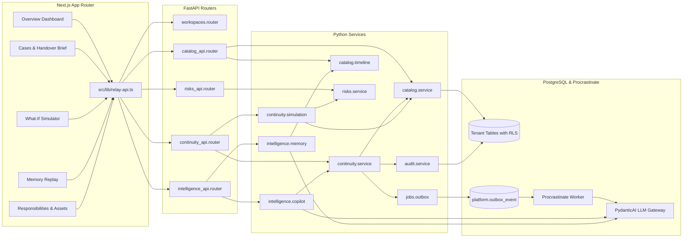

# 05 - File Communication Graph & Complete Codebase Mind Map

## 1. High-Level File Communication Architecture

Every feature in Relay flows through a strictly decoupled, 5-tier architecture:

```
[ Tier 1: Frontend Client UI & Action Forms ]
                     │  (Form submission / onClick)
                     ▼
[ Tier 2: Next.js Server Actions ] (frontend/src/app/w/[workspaceId]/**/actions.ts)
                     │  (api.* client calls with Bearer JWT)
                     ▼
[ Tier 3: FastAPI Routers ] (backend/src/relay/**/api.py)
                     │  (Pydantic StrictInput validation, Identity & WorkspaceAccess DI)
                     ▼
[ Tier 4: Python Domain Service Layer ] (backend/src/relay/**/service.py)
                     │  (authorize() check, audit.record(), outbox.emit())
                     ▼
[ Tier 5: PostgreSQL 18 with RLS & Procrastinate Background Workers ]
```

---

## 2. Backend Modules & Inter-File Communications (`backend/src/relay/`)

### 2.1 Core Infrastructure & Shared
* **`app.py`**: Application factory (`create_app`). Assembles FastAPI app, registers middlewares (`RequestContextMiddleware`), exception handlers (`PermissionDenied` audit logger), mounts all 20+ API routers, configures lifespan context (engine, HTTP client, WorkOS client, embedded worker).
* **`config.py`**: Pydantic `Settings` class reading environment variables (`RELAY_DATABASE_URL`, `RELAY_LLM_PROVIDERS`, WorkOS credentials, token budgets, etc.).
* **`worker.py`**: Standalone worker CLI entrypoint (`relay-worker`). Boots the Procrastinate worker app.
* **`models.py`**: Imports all domain ORM models into a unified SQLAlchemy `Base.metadata` to ensure cross-module foreign keys resolve.
* **`health.py`**: Endpoints for `/health/live` (process check), `/health/ready` (DB ping), and `/health/ops` (aggregate operational metrics).
* **`shared/db/session.py`**: Manages `TenantSession` and `unit_of_work()`. Injects transaction-local `set_config('app.tenant_id', ...)` via SQLAlchemy events.
* **`shared/db/engine.py`**: Creates async PostgreSQL engine using Psycopg 3.
* **`shared/errors.py`**: `ApiError` base class, global error formatting (`{code, message}`), and exception mapping.
* **`shared/observability.py`**: Request ID propagation, structlog/JSON logging, correlation tracking.

### 2.2 Security, Tenancy & Identity (`relay/identity/` & `relay/policy/`)
* **`identity/auth.py`**: FastAPI dependency `Identity`. Extracts Bearer JWT and calls `WorkOSTokenVerifier`.
* **`identity/tokens.py`**: Validates JWT signature against WorkOS JWKS, enforces issuer, audience, and algorithms (`RS256`).
* **`identity/workspace_access.py`**: The `CurrentWorkspace` dependency. Resolves active user membership without tenant context, then calls `establish_tenant_context()` to bind the transaction to the requested workspace.
* **`identity/members.py` & `members_api.py`**: Membership management, role assignments (`owner`, `admin`, `member`, `auditor`, `guest`), invitations.
* **`policy/permissions.py`**: Central permission registry (`Permission` enum). Functions `authorize(access, perm)` and `visible(access, perm, column)` for SQL list filtering.

### 2.3 Catalog & Stewardship (`relay/catalog/`)
* **`catalog/models.py`**: `Responsibility`, `OwnershipAssignment` (temporal valid-time range, EXCLUDE constraints), `OwnershipAssignmentChange` (immutable history), `Asset`, `KnowledgeItem`.
* **`catalog/service.py`**: Core catalog functions (`create_responsibility`, `assign_ownership`, `end_ownership`, `list_responsibilities`).
* **`catalog/timeline.py`**: Reconstructs the historical event timeline for a responsibility across Git, Linear, Notion, and Relay tasks.
* **`catalog/stewardship.py`**: Asset stewardship mappings (systems, cloud infra, repositories stewarded by responsibilities).
* **`catalog/knowledge.py` & `knowledge_governance.py`**: Knowledge document versioning, freshness review cadences, dispute resolution, cryptographic content hashing.

### 2.4 Continuity & Handover Cases (`relay/continuity/`)
* **`continuity/models.py`**: `ContinuityCase`, `CaseScopeItem`, `CaseTask`, `CaseReadinessCriterion`, `CaseApproval`, `CaseStatusChange`, `CaseBlocker`.
* **`continuity/lifecycle.py`**: Pure state machine defining allowed case status transitions and recording status history.
* **`continuity/service.py`**: High-level case operations (`create_case`, `submit_case`, `approve_case`, `execute_case`, `complete_case`). Executes ownership transfers atomically in PostgreSQL.
* **`continuity/simulation.py`**: The **"What If?" Continuity Simulator**. Recomputes coverage, open work, exposed risks, and readiness score entirely in memory without writing to the database.
* **`continuity/briefing.py`**: Computes return briefings for employees returning from temporary leave.
* **`continuity/external.py`**: Creates approved tracking issues in external tools (GitHub, Linear) using transactional idempotency.

### 2.5 Intelligence & AI Pipeline (`relay/intelligence/`)
* **`intelligence/models.py`**: `AgentRun`, `Evidence`, `Claim`, `ClaimEvidence`, `Capsule`, `CapsuleVersion`, `CapsuleAck`, `CapsuleQuestion`.
* **`intelligence/evidence.py`**: Context builder that pulls authorized evidence, wraps it in untrusted `<evidence>` XML tags, and computes SHA-256 pool hashes.
* **`intelligence/deterministic.py`**: Deterministic rule-based analysis (runs without any LLM configured; detects missing owners, stale docs, conflicting runbooks).
* **`intelligence/capabilities.py`**: Prompts, output schemas, and read-only tools for the 4 AI agent steps: Discovery, Impact Analyst, Knowledge Steward, Handover Planner.
* **`intelligence/llm.py`**: `LLMPort` gateway over PydanticAI. Implements 4-key Gemini rotation, Groq fallback, local Ollama fallback, and token/cost accounting.
* **`intelligence/validate.py`**: Citation verification. Rejects claims with invented or missing sources; applies audience narrowing.
* **`intelligence/capsules.py`**: Assembles role-specific Handover Briefs (`CapsuleVersion`) and handles manager approvals and recipient acknowledgments.
* **`intelligence/copilot.py`**: **Handover Copilot**. Grounded Q&A over capsule evidence with strict citation requirements and fallback to labeled search.
* **`intelligence/memory.py`**: **Project Memory Replay Narrator**. Synthesizes narrative chapters and causal links over chronological timeline events.
* **`intelligence/instant.py`**: Real-time synchronous AI invocation wrapper for Copilot and Memory Replay with budget enforcement.

### 2.6 Integrations (`relay/integrations/`)
* **`integrations/github/`**:
  - `client.py`: Asynchronous GitHub REST/GraphQL client using installation access tokens.
  - `service.py`: Installation OAuth handshakes, repository synchronization, CODEOWNERS and Backstage `catalog-info.yaml` parsing.
  - `webhooks.py`: HMAC signature verification, delivery deduplication, periodic reconciliation task (`relay.github_reconcile`).
* **`integrations/linear/`**:
  - `client.py` & `service.py`: Linear OAuth connection, project and issue ingestion, rolling 90-day contributor identity reconciliation.
* **`integrations/notion/`**:
  - `client.py` & `service.py`: Notion OAuth connection, page hierarchy discovery, fail-closed mapped page ingestion into knowledge items.

### 2.7 Platform, Governance, Risks & Jobs (`relay/`)
* **`jobs/outbox.py` & `jobs/app.py`**: Transactional outbox producer (`emit`) and consumer (`process`), Procrastinate task registration, stalled job retry task.
* **`audit/service.py`**: Append-only audit logger (`audit.record`) storing actor, action, tenant, timestamp, and metadata.
* **`risks/service.py`**: Deterministic risk detector (uncovered responsibilities, single-person bottlenecks, inactive owners).
* **`platform/workspaces.py` & `deletion.py`**: Tenant lifecycle, workspace creation, soft deletion with 30-day grace, owner purge CLI.
* **`demo/seed.py`**: Seeds synthetic "Northwind Labs" demo organization.

---

## 3. Frontend Modules & User Journeys (`frontend/src/`)

### 3.1 App Router Layout & Authentication
* **`proxy.ts`**: WorkOS AuthKit middleware protecting all paths except `/`, `/sign-in`, `/callback`, and webhooks.
* **`app/layout.tsx`**: Root HTML shell with font configuration, metadata, and Tailwind styling.
* **`app/callback/route.ts`**: WorkOS OAuth callback handler setting encrypted session cookie.
* **`app/workspaces/`**: Workspace switcher and creator (`create-workspace-form.tsx`, `sample-workspace-form.tsx`).

### 3.2 Workspace Shell & Context (`app/w/[workspaceId]/`)
* **`layout.tsx`**: Loads workspace metadata, user role, active handovers banner, sidebar navigation (`sidebar-nav.tsx`), command palette (`command-menu.tsx`), and tour system (`tour.tsx`).
* **`page.tsx`**: The main Overview Dashboard. Displays continuity health score, active handovers, urgent risks, and getting-started checklists.
* **`actions.ts`**: Global server actions (sync profile, switch workspace).

### 3.3 The Core Feature Pages
* **`cases/[caseId]/page.tsx`**: Continuity Case Hub. Displays ownership transfer plan, tasks checklist, separation-of-duties approval controls, collaboration thread.
* **`cases/[caseId]/analysis/page.tsx`**: Visualizes AI & deterministic findings, citations inspector, proposal acceptance buttons.
* **`cases/[caseId]/capsules/[capsuleId]/page.tsx`**: The **Handover Brief**. Features interactive **Handover Copilot** Q&A, coverage breakdown, next-steps roadmap, version comparison diffs, and acknowledgment button.
* **`simulator/page.tsx`**: The **"What If?" Continuity Simulator**. Person selector, duration slider, candidate cover comparison table, overload warnings, and one-click "Plan real handover" button.
* **`responsibilities/[responsibilityId]/timeline/page.tsx`**: The **Project Memory Replay**. Timeline event player, category filtering chips, AI narrative chapter axis, event inspector, and history Q&A box.

---

## 4. Complete Inter-Module Dependency Mind Map


