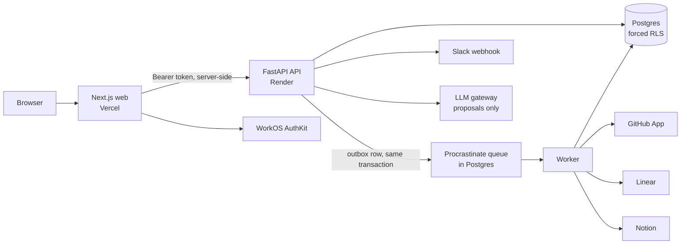
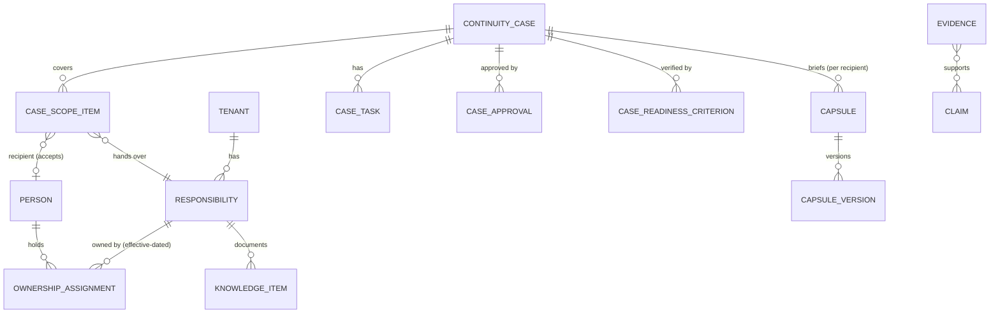
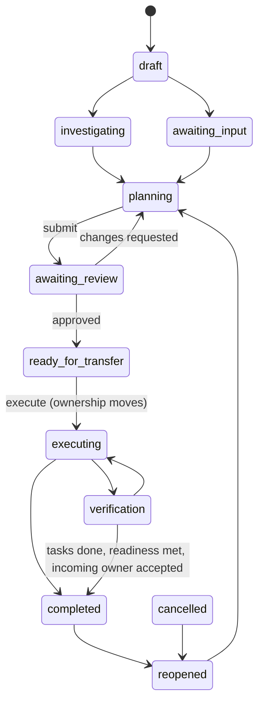

# Relay: architecture (Round 3)

Relay is a **modular monolith**: one FastAPI service, one worker, one Next.js web app and one
Postgres database. Business logic lives only in Python; the web app renders and calls the API.

## Request path

Every protected call follows the same path:

**Browser → Next.js server action → API → identity (WorkOS JWT) → workspace membership →
`authorize()` in the service → `unit_of_work` (sets `app.tenant_id` per transaction) →
Postgres with forced row-level security → audit event in the same transaction →
outbox event for background work.**

- Identity, membership and authorization are separate steps
  (`identity/`, `identity/workspace_access.py`, `policy/permissions.py`).
- Every tenant table has `tenant_id NOT NULL`, composite foreign keys and an `ENABLE + FORCE`
  RLS policy. `tests/security/test_schema_conventions.py` fails the build if one doesn't.
- The app connects as `relay_app`: no superuser, no BYPASSRLS, owns nothing. Migrations run
  separately as the owner role (`.github/workflows/migrate.yml`).

## Modules (`backend/src/relay/`)

| Module | Responsibility |
|---|---|
| `catalog/` | Responsibilities, ownership (effective-dated assignments), assets, knowledge, timeline, code drift |
| `continuity/` | Cases and their lifecycle (status model, scope, approvals, tasks, readiness, acceptance, completion), simulator, follow-through, 30/60/90 plan |
| `intelligence/` | Evidence pools, case analysis, Autopilot, interviews, handover briefs, Copilot, Memory Replay narrative, meetings, Ask Relay, rehearsal |
| `integrations/` | GitHub App, Linear, Notion, Slack; connector health and runs |
| `risks/`, `insights/` | Rule-based continuity risks, debt, coverage metrics |
| `identity/`, `policy/`, `audit/` | Members, roles, permission registry, append-only audit |
| `jobs/` | Transactional outbox and Procrastinate worker |
| `shared/` | Errors, DB helpers, idempotency, API types |

## Data model (core)

Ownership is **effective-dated**: a transfer ends the old assignment and starts a new one;
history is never overwritten. The simulator reads the same data and never writes
(`tests/test_simulation.py` fails on any INSERT, UPDATE or DELETE).

## Handover lifecycle

Any status before execution can be cancelled; any open status can be marked blocked and
returns to where it was (`continuity/lifecycle.py: TRANSITIONS`).

Completion is enforced server-side (`continuity/service.py: complete_case`):
- every mandatory readiness check is met or waived;
- no task is still open (temporary cover that ends early is exempt; open work goes back to
  the returning owner);
- every incoming person who uses Relay has **accepted** the responsibility
  (`continuity/workflow.py: accept`);
- critical cases also need separation of duties.

## AI pipeline

**Source ingestion → normalisation → permission filtering → evidence pool with refs →
model (structured output) → citation validation → human review → applied change.**

- The model gets evidence as `<evidence ref="E3">` blocks, marked as untrusted data, with
  two read-only tools. It has no write tools (`intelligence/capabilities.py`).
- Output schemas require an `evidence` list on every claim, proposal, question and answer.
  Citations to refs that weren't given are removed; uncited claims are dropped
  (`intelligence/validate.py`).
- The pool is built for the viewer: evidence they can't see never reaches the model.
- Model output is a **proposal**. A person accepts or rejects it, and only then does it
  change anything.
- Deterministic parts don't use the model at all: risks, coverage, the simulator, evidence
  strength, "Who to ask", rehearsal grading and the meeting fallback extractor.

## Reliability mechanisms

| Concern | Mechanism |
|---|---|
| Double submit / retry | `Idempotency-Key` per submission intent (`shared/idempotency.py`, table `platform.request_key`); same key + same request returns the first result; same key + different request returns 422 |
| Concurrent edits | Row locks (`with_for_update`) on cases, scope items, proposals; plan versions on approvals |
| Background work | Transactional outbox; idempotent handlers; connector runs recorded with status |
| Incremental sync | GitHub activity resumes from a stored checkpoint minus a 15-minute overlap; a full window runs daily to reconcile (`github/service.py: activity_window`) |
| Webhooks | GitHub deliveries deduplicated by delivery id; HMAC-verified |
| AI failure | Timeouts, provider fallback, budget and kill switch; failures recorded with a reason and shown in plain words |
